<!-- Generated by src/cli/build.ts from data/*.ts. Edit the data, not this file. -->

<a href="https://kan.run"><picture><source media="(prefers-color-scheme: dark)" srcset="assets/generated/hero-dark.svg"></picture></a>

広島を拠点に、AI エージェント、Web サービス、開発者向けツール、写真・映像・音を扱うソフトウェアをつくっています。思いついたものをすばやく形にして、企画から実装、公開、運用まで自分で進めるのが好きです。

### NOW いまやっていること

- YouTube 向けの自動編集 AI と映像制作
- 動画の映像解析と音声文字起こしを組み合わせる AI ツール
- TeslaCam 映像の整理・同期再生・合成動画出力
- DGX Spark を使ったローカル LLM の実用検証
- AI エージェントと小さな公開プロダクト

### CONTACT SHEET つくったもの

<a href="https://giga-site.com/"><picture><source media="(prefers-color-scheme: dark)" srcset="assets/generated/frames/01-giga-site-dark.svg"></picture></a>
<a href="https://github.com/kandotrun/afterimage-app"><picture><source media="(prefers-color-scheme: dark)" srcset="assets/generated/frames/02-afterimage-app-dark.svg"></picture></a>
<a href="https://github.com/kandotrun/kururi-ai"><picture><source media="(prefers-color-scheme: dark)" srcset="assets/generated/frames/03-kururi-ai-dark.svg"></picture></a>
<a href="https://txt.2-38.com/"><picture><source media="(prefers-color-scheme: dark)" srcset="assets/generated/frames/04-txt-dark.svg"></picture></a>
<a href="https://human-required-blog.2-38.com"><picture><source media="(prefers-color-scheme: dark)" srcset="assets/generated/frames/05-human-required-blog-dark.svg"></picture></a>
<a href="https://github.com/mukumo/tamago-muku"><picture><source media="(prefers-color-scheme: dark)" srcset="assets/generated/frames/06-tamago-muku-dark.svg"></picture></a>
<a href="https://teslacam.2-38.com/"><picture><source media="(prefers-color-scheme: dark)" srcset="assets/generated/frames/07-teslacam-viewer-dark.svg"></picture></a>
<a href="https://send.2-38.com"><picture><source media="(prefers-color-scheme: dark)" srcset="assets/generated/frames/08-send-dark.svg"></picture></a>
<a href="https://github.com/kandotrun/hermes-video-understanding"><picture><source media="(prefers-color-scheme: dark)" srcset="assets/generated/frames/09-hermes-video-understanding-dark.svg"></picture></a>
<a href="https://github.com/kandotrun/x-mcp"><picture><source media="(prefers-color-scheme: dark)" srcset="assets/generated/frames/10-x-mcp-dark.svg"></picture></a>
<a href="https://jrm-demo.2-38.com/"><picture><source media="(prefers-color-scheme: dark)" srcset="assets/generated/frames/11-jrm-dark.svg"></picture></a>
<a href="https://github.com/kandotrun/supercamera"><picture><source media="(prefers-color-scheme: dark)" srcset="assets/generated/frames/12-supercamera-dark.svg"></picture></a>

### HISTOGRAM 使っている言語と活動量

<picture><source media="(prefers-color-scheme: dark)" srcset="assets/generated/stats-dark.svg"></picture>

### CONTRIBUTION SCAN 直近 1 年の草

<picture><source media="(prefers-color-scheme: dark)" srcset="assets/generated/contrib-dark.svg"></picture>

### MEDIA 新しい記事と人気の動画

#### Zenn 新着記事

- `2026-06-22` · [AI生成HTMLを「信頼せず」に配信する ― Cloudflare Workers + Hono で作る認証付きホスティングの設計](https://zenn.dev/nixo/articles/8f5807a6cefd36)
- `2026-06-12` · [【国内最強(俺調べ)】「辛いラーメン」を「つらいラーメン」と読むTTSにキレて、日本語読み推定モデルを自作した【1268問ベンチマーク】](https://zenn.dev/nixo/articles/3139042d4034f2)
- `2026-05-27` · [【2026・夏最新版】皆様にGoogle CloudでのRAG・Embeddingの最強を、お伝えしたかった。](https://zenn.dev/fp16/articles/c3a080a68b3b59)
- `2026-05-26` · [【調子いい!!】令和のスクレイピングは、これが良いと思う。【Perplexity Agent API】](https://zenn.dev/fp16/articles/58ae408cdd5539)
- `2026-02-12` · [【2026年版】日本語RAGのEmbeddingモデル、結局どれが最強なのか？6構成で2000問ベンチマークした](https://zenn.dev/fp16/articles/aa48dcae23974e)

#### YouTube 再生数トップ 3

<table align="left">
<tr>
<td width="246" valign="top"> ▶ 7.1万回再生 <a href="https://www.youtube.com/watch?v=vwBRNTa6gVY">Mac mini品薄だけど、ローカルLLMは実用的じゃない【エンジニアの本音】</a></td>
</tr>
</table>
<table align="left">
<tr>
<td width="246" valign="top"> ▶ 4万回再生 <a href="https://www.youtube.com/watch?v=8FmOzkeUvJ8">3万円 vs 100万円 vs 300万円｜ローカルLLMはいくらあれば快適に動くのか検証してみた</a></td>
</tr>
</table>
<table align="left">
<tr>
<td width="246" valign="top"> ▶ 9,544回再生 <a href="https://www.youtube.com/watch?v=rRWcNvxJvfk">90万円のDGX SparkでDeepSeek V4を動かした結論。MacBookでいい</a></td>
</tr>
</table>

 

### SENSORS センサー

 

### WORK 最近つくっているもの

- [ギガサイト便](https://giga-site.com/) — HTML や zip をすぐに共有サイトとして公開できるサービス
- [{TRAC}](https://apps.apple.com/us/app/trac-travel-memories/id6755861910) — 旅の記憶を残す iPhone アプリ
- 月間約 500 万 PV 規模のクローズドな Web サービス群
- AI エージェント、ユーティリティ、インターネットツールまわりの OSS

### PRODUCTS プロダクト

- **Tashika** — 日本語の技術口述や文字起こしを補正する API（[Demo](https://voice.2-38.com/demo)）
- **JRM (Japanese Reading Model)** — 日本語の読み・発音・TTS 前処理のためのクローズドソースモデル（[Demo](https://jrm-demo.2-38.com/)）
- **Voice2Agent** — 音声メモを Hermes、Claude Code、Codex、ChatGPT へ渡しやすいプロンプトに整えるデモ（[Demo](https://voice2agent.2-38.com/)）

### OSS オープンソース

#### AI / エージェント

- [reframe](https://github.com/kandotrun/reframe) — 変化を追える根拠と意思決定のワークスペース。PyTorch で学習し、ブラウザの WASM で推論（[Live](https://reframe.2-38.com)）
- [r1-hermes](https://github.com/kandotrun/r1-hermes) — Rabbit R1 から Hermes Agent を安全に使うためのゲートウェイアダプター
- [gemini-indoor-localization](https://github.com/kandotrun/gemini-indoor-localization) — Gemini Embedding 2 を使った参照画像ベースの屋内位置推定

#### ツール / アプリ

- [traceglass](https://github.com/kandotrun/traceglass) — Rust、GPUI Kit、WebAssembly でつくったブラウザイベントエクスプローラー（[Live](https://traceglass.2-38.com)）
- [life-atlas](https://github.com/kandotrun/life-atlas) — Google Timeline のエクスポートを地図とタイムラインでローカル閲覧するダッシュボード
- [tapo-care-backup](https://github.com/kandotrun/tapo-care-backup) — 自分の Tapo Care クラウド録画をバックアップする非公式 CLI / watcher
- [koreka](https://github.com/kandotrun/koreka) — 次に何をするかを決めるリアルタイムカード投票 PWA
- [kaiwa](https://github.com/kandotrun/kaiwa) — Cloudflare Workers と WebRTC でつくるプログラマブルネットワーク

アーカイブ済み

- [oura-arena](https://github.com/kandotrun/oura-arena) — Oura Ring API を使ったチーム向けウェルネスダッシュボード
- [ai-chat-export-chrome-extension](https://github.com/kandotrun/ai-chat-export-chrome-extension) — ChatGPT、Claude、Gemini の会話をローカルで Markdown に書き出す Chrome 拡張
- [hermes-symphony-token-card](https://github.com/kandotrun/hermes-symphony-token-card) — Hermes Agent と Symphony のトークン使用量を README に貼れるバッジ
- [dgx-spark-deepseek-v4-flash](https://github.com/kandotrun/dgx-spark-deepseek-v4-flash) — DGX Spark 1 台で DeepSeek V4 Flash を動かす vLLM 構成と実測
- [yolo-hud-overlay](https://github.com/kandotrun/yolo-hud-overlay) — 動画にテーマ切り替え可能な YOLO HUD を重ねるツール
- [daihugou](https://github.com/kandotrun/daihugou) — Cloudflare Workers + Durable Objects で動くオンライン大富豪
- [nandaro](https://github.com/kandotrun/nandaro) — 画像をサーバーに送らず、ブラウザだけでリサイズ・再圧縮するツール
- [raycast-clipboard-extension-its-free](https://github.com/kandotrun/raycast-clipboard-extension-its-free) — macOS + Raycast 向けの無料・無制限クリップボード履歴
- [pochimo](https://github.com/kandotrun/pochimo) — ブラウザカメラの記録を AI で日記にする実験的なペット日記アプリ
- [openclaw-supermemory](https://github.com/kandotrun/openclaw-supermemory) — エージェントの応答前に supermemory から文脈を呼び出す OpenClaw プラグイン

